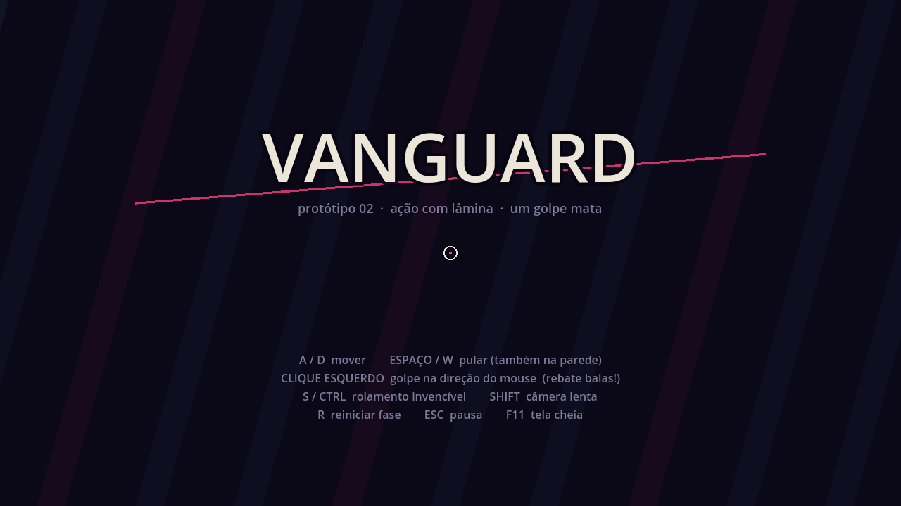
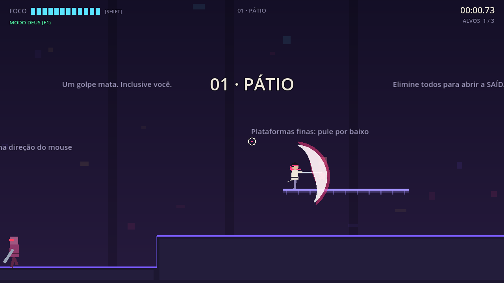
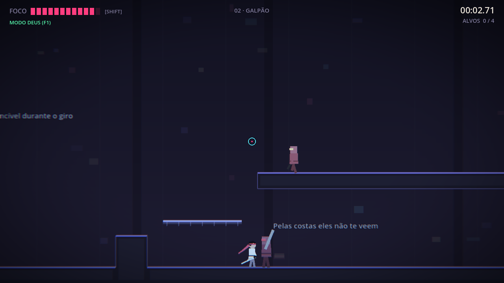

# VANGUARD — Protótipo 02 (Godot 4)

Plataforma de ação 2D no estilo **"um golpe mata"**: lâmina na direção do mouse,
rebater balas, câmera lenta, rolamento invencível e reinício instantâneo.
Tudo é desenhado por código (formas provisórias), então o projeto roda sem nenhum asset.





## Como abrir
1. Instale o **Godot 4.3** ou superior (versão padrão, não precisa da .NET).
2. No Project Manager: **Importar** → selecione o `project.godot` desta pasta.
3. Aperte **F5** para jogar.

## Controles
| Ação | Tecla |
|---|---|
| Mover | A / D (ou setas) |
| Pular (também na parede) | Espaço / W |
| Golpe (na direção do mouse) | Clique esquerdo |
| Rolamento invencível | S / Ctrl (no chão) |
| Descer de plataforma fina | S parado em cima dela |
| Mergulho rápido | S no ar |
| Câmera lenta | Shift (segurar) |
| Reiniciar fase | R |
| Pausa | Esc |
| Tela cheia | F11 |

**Atalhos de teste** (só rodando pelo editor): `F1` modo deus · `F2` mata todos · `F3` pula fase.

## Mecânicas
- **Um acerto mata** — você e os inimigos. Morreu? Clique ou `R` e volta na hora.
- **Golpe**: dá um impulso na direção do mouse (inclusive para cima, 1x por pulo). Mata inimigos e **rebate balas**.
- **Bala rebatida** fica ciano e mata inimigos.
- **Rolamento**: invencível durante o giro (balas e golpes atravessam).
- **Parede**: segure contra a parede para deslizar; pule para escalar.
- **Câmera lenta (FOCO)**: a barra gasta enquanto segura Shift e recarrega sozinha.
- **Inimigos**:
  - *Atirador* — ao te ver, mira com um **laser**; nos últimos instantes a mira trava (hora de reagir) e ele atira.
  - *Escopeta* — mira mais devagar, 5 projéteis de curto alcance.
  - *Brutamontes* — corre até você, pisca branco (aviso) e golpeia.
  - Patrulhando, só enxergam **na frente**. Matar um alerta os vizinhos.
- A **saída** abre quando todos os inimigos morrem. Cronômetro e recorde por fase.

## Estrutura
```
project.godot          configuração, controles (Input Map) e camadas de física
scenes/                main, player, enemy, bullet (.tscn com colisões)
scripts/
  game.gd              autoload "Game": câmera lenta, hitstop, tremida, camadas
  sfx.gd               autoload "Sfx": sons provisórios gerados por código
  main.gd              fluxo: título → fase → morte/reinício → próxima fase
  levels.gd            ★ DADOS DAS FASES (mapas em texto) — edite aqui
  level.gd             transforma o mapa em colisão + cenário
  player.gd            jogador (todos os números ajustáveis no Inspetor)
  enemy.gd             inimigos (tabela STATS no topo para balancear)
  bullet.gd            balas (raycast, podem ser rebatidas)
  exit_door.gd         porta de saída
  game_camera.gd       câmera (segue, olha para o mouse, treme)
  hud.gd               interface e telas
  fx.gd                efeitos: sangue, faíscas, arco do golpe, fantasmas
tests/
  smoke_test.tscn      teste automático (mapas + mecânicas)
  screenshots.tscn     gera capturas de tela
```

## Criando / editando fases
Abra `scripts/levels.gd`. Cada fase é um mapa de texto, cada caractere = bloco de 32×32 px:

```
#  parede            -  plataforma fina        P  jogador      D  saída
g / G  atirador      s / S  escopeta           b / B  brutamontes
(minúscula = olhando para a esquerda, MAIÚSCULA = para a direita)
```

Regras práticas (já testadas): o pulo alcança **3 blocos** de altura; personagens e
a porta precisam de chão logo abaixo; a borda do mapa deve ser toda `#`.
Depois de editar, rode o teste — ele aponta mapa torto, gente flutuando, etc.

## Ajuste fino (game feel)
- **Jogador**: selecione `scenes/player.tscn` → Inspetor → grupos *Movimento, Parede, Rolamento, Golpe*.
- **Inimigos**: tabela `STATS` no topo de `scripts/enemy.gd` (visão, tempo de mira, velocidade da bala...).
- **Câmera lenta**: constantes `SLOWMO_*` em `scripts/game.gd`.

## Teste automático
Valida os 5 mapas e simula: golpe, bala, rolamento, rebater bala, mira do atirador,
câmera lenta, escalada dos poços, plataforma fina, abrir porta e concluir cada fase.
```bash
godot --headless --path . res://tests/smoke_test.tscn
```
Termina com `RESULTADO: TUDO OK` (código de saída 0) ou lista as falhas.

## Próximos passos sugeridos
**Arte** — trocar os desenhos de `_draw()` por sprites/animações (`AnimatedSprite2D`): correr, pular, golpe, rolar, morrer. Tileset para as paredes.
**Áudio** — trocar os sons sintetizados (ver comentário no topo de `sfx.gd`) e adicionar música.
**Programação** — objetos arremessáveis (botão direito), portas que se abrem com chute, inimigo com escudo, armadilhas (laser/torreta), salvar recordes em arquivo, menu de opções (volume, remapear teclas), suporte a controle.
**Level design** — mais fases usando o formato de texto; testar com gente de fora da equipe e medir tempo/mortes.

O protótipo 01 original continua no histórico do git (primeiro commit).
