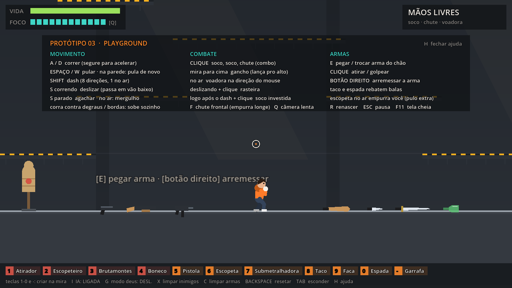
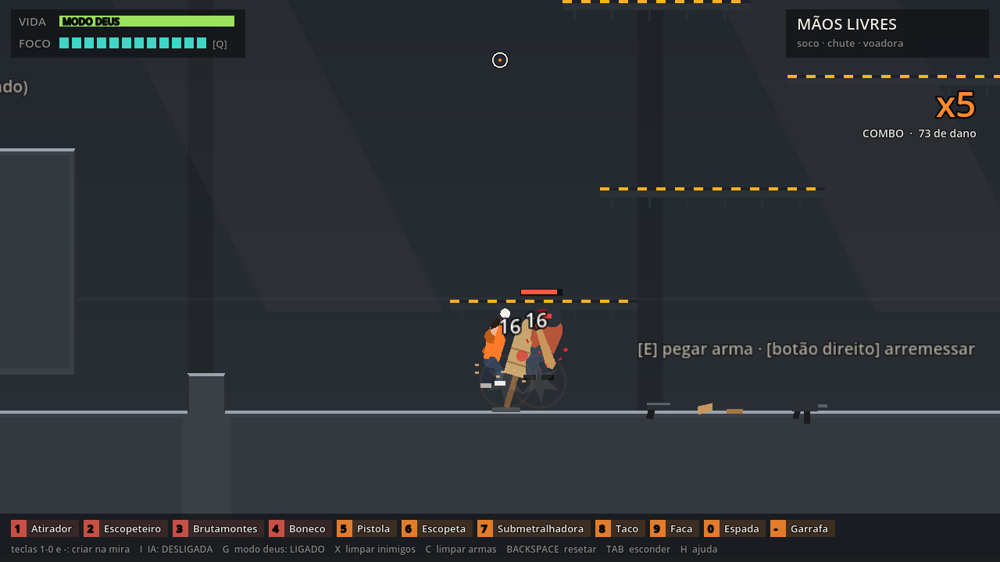
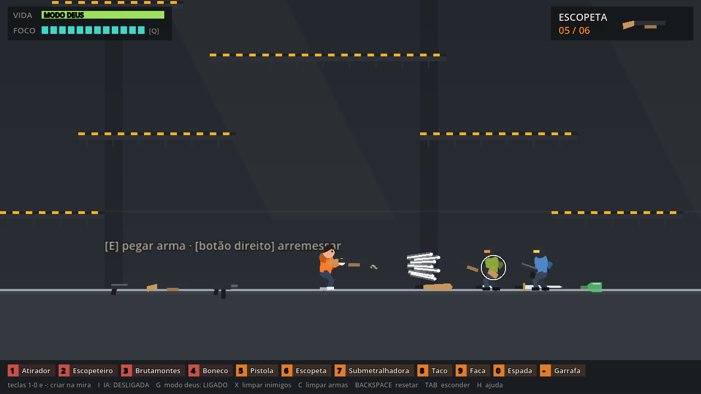
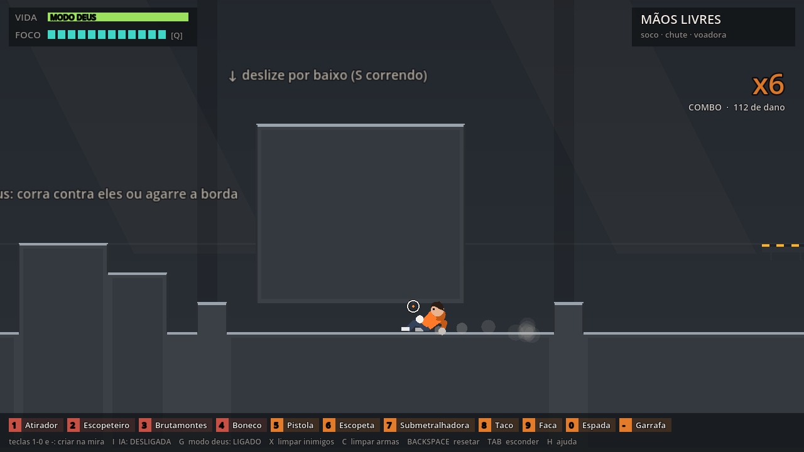

# Projeto — Protótipo 03: Playground (Godot 4)

> Nome do jogo ainda não definido — para trocar, mude `GAME_TITLE` em `scripts/hud.gd` e `config/name` no `project.godot`.

Playground 2D de **luta corpo a corpo, armas e parkour**. Um único cenário (galpão industrial)
dividido em 3 zonas — **PARKOUR**, **ARENA** e **RAMPAS** — onde você cria inimigos e armas na
mira e testa à vontade. O personagem começa **de mãos livres**: soco, chute, gancho, voadora,
rasteira... e pega armas do chão. Tudo desenhado por código (sem assets), com animação por
"esqueleto" interpolado e interpolação de física (fica liso em monitor de 120/144 Hz).






## Como jogar
- **Sem instalar nada:** baixe o `.exe` (Windows) que a equipe distribuir e abra.
- **Pelo Godot 4.3+:** Importar → `project.godot` → **F5**.

## Controles
| Ação | Tecla |
|---|---|
| Correr (segurar acelera até o sprint) | A / D |
| Pular · pular de novo na parede | Espaço / W |
| Dash (8 direções, 1 no ar, invencível) | Shift |
| Deslizar (correndo) · agachar (parado) · mergulho (no ar) | S / Ctrl |
| Atacar / atirar (na direção do mouse) | Clique esquerdo |
| Chute frontal (empurra longe) | F |
| Pegar / trocar arma | E |
| Arremessar arma | Clique direito |
| Câmera lenta (barra FOCO) | Q |
| Renascer | R |
| Pausa · tela cheia | Esc · F11 |

### Playground
| Tecla | Faz |
|---|---|
| 1 / 2 / 3 / 4 | cria Atirador / Escopeteiro / Brutamontes / Boneco **na mira** |
| 5 / 6 / 7 / 8 / 9 / 0 / - | cria Pistola / Escopeta / Submetralhadora / Taco / Faca / Espada / Garrafa |
| I | liga/desliga a IA (inimigos viram sacos de pancada) |
| G | modo deus |
| X · C | remove inimigos · remove armas |
| Backspace | reseta o playground |
| Tab · H | esconde a barra de spawn · mostra a ajuda |

## Mecânicas
**Parkour:** sprint que acelera · dash 8 direções · deslize que passa por vãos de 1 bloco e
**acelera na descida das rampas** · pulo durante deslize/dash = pulo longo · **vault** automático
em obstáculos baixos · **agarrar borda** e subir · pulo na parede · plataformas de salto ·
plataformas finas (S parado em cima desce).

**Combate desarmado:** clique = soco → soco → chute (combo) · mira para cima = gancho (lança o
inimigo) · no ar = voadora na direção do mouse (e soco aéreo para malabarismo) · clique deslizando
= rasteira · clique logo após o dash = soco investida · F = chute frontal.
Inimigos ficam atordoados, caem, batem na parede (dano extra) e derrubam outros no caminho.
Golpes no ar mantêm o inimigo no alto. Hitstop, tremida, números de dano e contador de combo.

**Armas** (tabela em `scripts/weapons.gd`):

| Arma | Tipo | Detalhe |
|---|---|---|
| Pistola | tiro | 12 balas, 2 tiros derrubam um atirador |
| Escopeta | tiro | 7 projéteis; atirando no ar empurra você (pulo extra) |
| Submetralhadora | tiro | automática, 30 balas |
| Taco | corpo a corpo | empurra longe, derruba e **rebate balas** |
| Faca | corpo a corpo | rápida; **arremessada mata** um atirador |
| Espada | corpo a corpo | alcance longo, **rebate balas** |
| Garrafa | corpo a corpo | atordoa muito e quebra no 1º golpe |

Qualquer arma pode ser arremessada (botão direito) e machuca quem acertar. Inimigos largam a
arma ao morrer. Sem munição? Arremesse.

**Inimigos:** atirador (mira com laser — nos últimos instantes a mira trava, hora de desviar),
escopeteiro (rajada curta), brutamontes (grandão com taco, aguenta mais e só cai com golpe forte)
e boneco de treino (não morre, mostra o dano). Você tem 100 de vida, que regenera depois de 3 s
sem apanhar.

## Estrutura
```
project.godot            controles, camadas de física, interpolação
scenes/                  main, player, enemy, bullet
scripts/
  playground.gd          ★ O MAPA (texto) — edite aqui
  main.gd                playground: spawn na mira, IA, limpar, renascer, combo
  player.gd              jogador (números ajustáveis no Inspetor) + tabela MOVES dos golpes
  enemy.gd               inimigos (tabela STATS no topo)
  weapons.gd             tabela de armas + desenho
  weapon_item.gd         arma solta no chão (física, arremesso)
  rig.gd                 "esqueleto" com cinemática inversa usado nas animações
  level.gd               transforma o mapa em colisão + cenário
  jump_pad.gd, bullet.gd, game_camera.gd, hud.gd, fx.gd
  game.gd                autoload: câmera lenta, hitstop, IA on/off, modo deus
  sfx.gd                 autoload: sons provisórios gerados por código
tests/
  smoke_test.tscn        teste automático
  screenshots.tscn       gera capturas de tela
```

## Editando o mapa
`scripts/playground.gd` — cada caractere é um bloco de 32×32 px:
```
#  parede      -  plataforma fina      /  \  rampas      J  plataforma de salto
P  jogador     g/G atirador   s/S escopeteiro   b/B brutamontes   d boneco
1 pistola  2 escopeta  3 submetralhadora  4 taco  5 faca  6 espada  7 garrafa
```
Regras (testadas): o pulo sobe ~3 blocos; vão de 1 bloco só passa deslizando; obstáculo de 1
bloco o personagem pula sozinho correndo; até ~2,5 blocos ele agarra a borda.

## Ajuste fino
- **Movimento:** `scenes/player.tscn` → Inspetor → grupos *Corrida, Pulo, Parede, Dash, Deslize, Vida*.
- **Golpes:** tabela `MOVES` no topo de `scripts/player.gd` (dano, duração, alcance, empurrão).
- **Armas:** `scripts/weapons.gd`. **Inimigos:** `STATS` em `scripts/enemy.gd`.

## Teste automático
Valida o mapa e faz 45 checagens: combo, gancho, pegar/atirar, arremessar faca, taco
rebatendo bala, dano/morte/renascimento, dash, deslize no túnel, vault, agarrar borda, escalar a
torre, plataforma de salto, rampa, câmera lenta, spawn na mira, IA on/off e limpar.
```bash
godot --headless --path . res://tests/smoke_test.tscn
```

## Gerar o .exe (Windows)
O `export_presets.cfg` já vem configurado (arquivo único).
1. Godot: **Editor → Gerenciar modelos de exportação → Baixar e instalar** (1ª vez).
2. **Projeto → Exportar → Windows Desktop → Exportar projeto**.

Linha de comando: `godot --headless --path . --export-release "Windows Desktop" build/windows/prototipo_03.exe`

O Windows pode avisar "O Windows protegeu o computador" (o .exe não é assinado): **Mais informações → Executar assim mesmo**.

## Próximos passos sugeridos
- **Arte:** trocar o desenho do `rig.gd` por sprites/animações; tileset do galpão.
- **Áudio:** sons reais (veja o topo de `sfx.gd`) e música.
- **Gameplay:** agarrar/arremessar inimigos, contra-ataque (parry), corrida na parede, tirolesa, inimigos que pegam armas do chão, ondas de inimigos (modo arena), suporte a controle.
